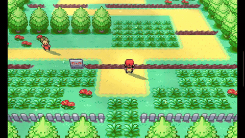
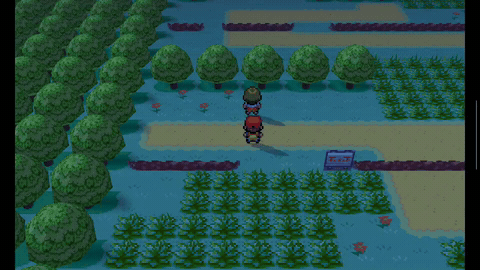
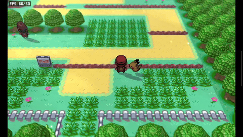
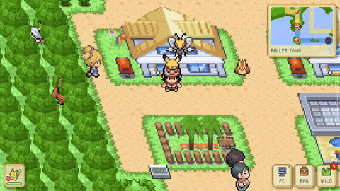
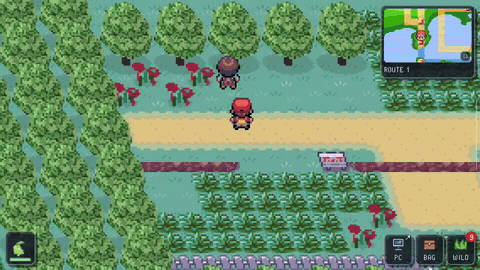
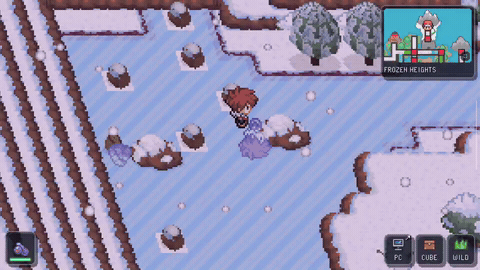
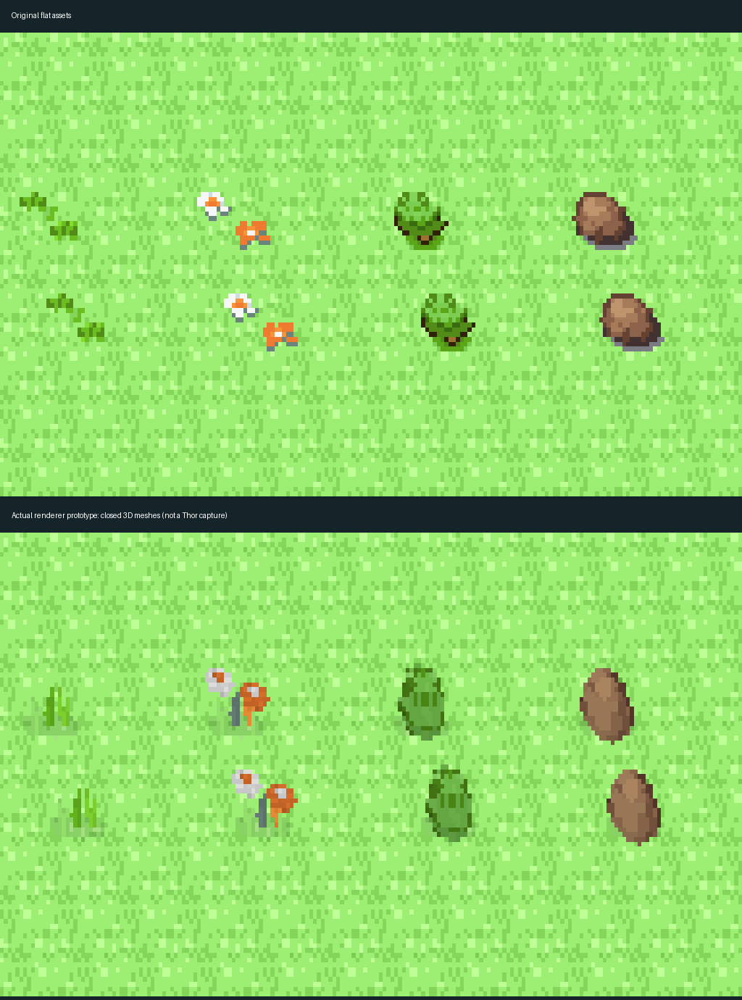

<p align="center">
  
</p>

# Pokémon FireRed 3DS for Azahar

**Proudly vibe coded.** This fork brings FireRed 3DS to Azahar on Android, with
the AYN Thor as the target handheld. Choose your game and matching local
ROM in the shared builder, then download and install the result.

The game is a native Nintendo 3DS port with a dual-screen interface and a
voxel-styled 3D world. The builder uses this fork's cartridge engine and a
matching data recipe based on upstream v0.5.1. You supply your own FireRed
cartridge dump.

**[Project website](https://zempoh.github.io/Pokemon-FireRed-3DS-Azahar/)**
· **[Shared voxel builder](https://zempoh.github.io/Pokemon-FireRed-3DS-Azahar/voxel.html)**
· **[Graphics preview release](https://github.com/ZempOh/Pokemon-FireRed-3DS-Azahar/releases/tag/graphics-upgrade-2026-11-18)**

## Six-game graphics preview

The [shared builder](https://zempoh.github.io/Pokemon-FireRed-3DS-Azahar/voxel.html)
provides FireRed 3DS, FireRed & LeafGreen+ v1.5.1, and Pokémon Classic v1.5.1
for Azahar. The same page links the PokéDaisy Android preview for Let's Go
Pikachu (English translation), Radical Red 4.10, and Unbound 2.1.1.1.
You supply each matching ROM; ROMs and saves are not included in releases.

The November 18 graphics preview adds optional per-game seasons and weather,
with **Original**, **Automatic**, and **Manual** controls. Climate defaults to
Original, and effect detail starts at Reduced. PokéDaisy also improves
projected sprite depth and terrain-contact shading; FireRed and FRLG+ use
stable camera framing across connected maps.

The initial preview passed the documented early-game Thor checks. See the
[per-game results, measured performance, and known limitations](https://zempoh.github.io/Pokemon-FireRed-3DS-Azahar/graphics-upgrade.html)
for the tested routes and exact artifact hashes. This is not full-playthrough
certification. The [release page](https://github.com/ZempOh/Pokemon-FireRed-3DS-Azahar/releases/tag/graphics-upgrade-2026-11-18)
contains the APK, clean source snapshots, patches, and ROM-free build kits.

## Android pacing follow-up and graphics gallery

Let’s Go Pikachu, Radical Red and Unbound passed the targeted AYN Thor field and battle retests. The shared APK uses native GBA timing (about 59.7275 FPS) instead of following the Thor’s fluctuating display ticks, and Let’s Go’s settings header now shows its own title. [Measured results and limits](https://zempoh.github.io/Pokemon-FireRed-3DS-Azahar/android-pacing.html) · [Download the passing APK](https://github.com/ZempOh/Pokemon-FireRed-3DS-Azahar/releases/download/graphics-upgrade-2026-11-18/PokeDaisy-Voxel-NativeClock-2026-11-18.apk).

All six games now have [2D/3D comparisons, four seasons and battle screenshots](docs/screenshots/graphics-gallery/README.md), also on the [website gallery](https://zempoh.github.io/Pokemon-FireRed-3DS-Azahar/gallery.html). The GIFs below show real Thor gameplay, compressed to 480 px / 10 FPS; they are not performance measurements.

| FireRed 3DS | FireRed & LeafGreen+ |
| --- | --- |
|  |  |

| Pokémon Classic | Pokémon Let’s Go Pikachu |
| --- | --- |
|  |  |

| Pokémon Radical Red | Pokémon Unbound |
| --- | --- |
|  |  |

## Ground animation and native battle pacing

The three native follow-up builds passed the targeted AYN Thor checks.
Classic's native animation update fixes ground speckles in Route 1/Pallet
flowers, water and shoreline in both 2D and voxel views. The earlier forest
border and PP/category fixes remain. FireRed and FRLG+ reduce redundant
scanline work, lower-screen redraws and top UI conversion; FireRed also
caches repeated glyph decoding. Rendering detail and game timing are retained.

| Cartridge | Steady selection minimum drawn FPS | Blinking text minimum drawn FPS | Fight/Back minimum drawn FPS |
| --- | ---: | ---: | ---: |
| FireRed V4 | 58.6 → 59.8 | 59.5 → 59.8 | 58.0 → 59.7 |
| FRLG+ V3 | 58.7 → 59.8 | 59.5 → 59.8 | 58.1 → 59.7 |

Before means the original published build for steady selection and the
withheld scanline-only build for controlled blink/menu input. The latter
alternates A/B every 1.5 seconds for 78 seconds without attacks/screenshots.
Full sample counts, game-rate ranges, matchups and exact hashes are in the
[measured report](https://zempoh.github.io/Pokemon-FireRed-3DS-Azahar/ground-pacing.html).

FireRed steady reported work was **12.645 → 9.100 ms**;
FRLG+ was **12.660 → 9.080 ms**. These are medians of 300-frame window averages,
not per-frame CPU medians. The excluded renderer-wait boundary changed, so
the work reductions are not all-scene CPU speedups; independent PACE counters
establish cadence. Classic's separate renderer samples remained at least
59.8 FPS, with field work 2.68 → 2.82 ms and battle work 5.345 → 5.42 ms.
Its opponents differed; this establishes maintained cadence, not reduced
battle work.

FRLG+ used Growl and three Tackle turns to defeat Pidgey and return to Route 1;
Medicine/Potion, all five pockets, PP and Party HP were correct. Classic
defeated Pidgey with ThunderShock and returned to the field; Route 1 → Pallet
map/ground checks also passed.
FireRed used Growl and three Scratch turns, defeated Rattata and returned to Route 1; Party agreed at 11/21 HP and the standard three-pocket Bag remained correct. In the measured phases, active Azahar audio tracks advanced with zero endpoint underruns. Original saves, settings and diagnostics were restored and verified, and all installed executable/data hashes matched the qualified candidates.
These are targeted early-game checks, not a guarantee that every scene is
free of stutter. That native follow-up retained the original PokéDaisy APK; the Android follow-up above supersedes it.

Use the [shared voxel builder](https://zempoh.github.io/Pokemon-FireRed-3DS-Azahar/voxel.html) or the
[ground/pacing follow-up bundle](https://github.com/ZempOh/Pokemon-FireRed-3DS-Azahar/releases/download/graphics-upgrade-2026-11-18/VoxelGraphics-Ground-Pacing-Fixes-2026-11-18.zip). The [release page](https://github.com/ZempOh/Pokemon-FireRed-3DS-Azahar/releases/tag/graphics-upgrade-2026-11-18)
retains the earlier native-fixes and initial-preview assets as historical
snapshots. The preceding Medicine, forest and PP results remain documented
in the [earlier native-fixes report](https://zempoh.github.io/Pokemon-FireRed-3DS-Azahar/native-fixes.html).

## Install and update

### Current native builds for Azahar

1. Open the [shared voxel builder](https://zempoh.github.io/Pokemon-FireRed-3DS-Azahar/voxel.html) and choose the game profile.
2. Select the matching local ROM shown by that profile, choose **Build .3ds
   cartridge** for FireRed or FRLG+, and download the result.
3. Fully close the game in Azahar, copy the cartridge into the folder Azahar
   scans and launch it. For updates, replace the existing cartridge; saves
   and settings stay in Azahar's virtual SD folder.

Classic produces a homebrew ZIP on the same page. Extract it and copy its
`3ds` folder into Azahar's `sdmc` folder, then launch `PokeClassicVoxel.3dsx`.
Each ROM is processed locally in the browser. The current native payloads
are also in the [matching ROM-free follow-up bundle](https://github.com/ZempOh/Pokemon-FireRed-3DS-Azahar/releases/download/graphics-upgrade-2026-11-18/VoxelGraphics-Ground-Pacing-Fixes-2026-11-18.zip). Keep engines
and recipes paired; earlier archives remain historical snapshots.

Azahar on Android defaults to HLE audio. The FireRed cartridge header maps
the required DSP memory; `debug.txt` only enables diagnostics.

### Map, 3D, and controller navigation

- Voxel 3D starts enabled with fresh settings. Tap **3D ON** or **3D OFF** on
  the lower-screen map while standing in the overworld to switch between
  voxel 3D and the classic view. Your saved preference carries over.
- Press **Start** in the overworld to focus the lower-screen dock. Use the
  **D-pad** to select Pokédex, Pokémon, Bag, your trainer card, Save, or Options,
  and press **A** to open it. Press **B** or **Start** to leave dock navigation.
- Opening **Options** with the controller starts on **3D WORLD**. Use **A** to
  toggle it, **Up/Down** to select another row, and **Left/Right** to adjust a
  setting. **L/R** change pages, **X/Y** change tabs, and **B** goes back. You can
  also use the touch gear and page arrows. The settings include audio, camera
  angle, zoom, battle presentation, and running.
- If the overlay Start works and the Thor's physical Start does not, check
  that the Thor button is bound to **Start** under Azahar's **Settings → Gamepad**.

### Compare 2D and 3D performance

1. Tap the bottom-screen gear, open **Settings**, and go to page 2. Turn on
   **Show FPS**, then go back to the map. The counter appears in the map's
   upper-right corner. Your choice persists across launches.
2. Walk the same route in each mode at normal speed. Use the map's **3D ON /
   3D OFF** switch and allow a few seconds for the scene and counter to settle.
3. The in-game counter counts presented frames using the emulated 3DS clock.
   To see how fast emulation is running on your Thor, use Azahar's
   [performance overlay](https://github.com/azahar-emu/azahar/discussions/1149)
   under **Layout** and enable **Speed**.

### Earlier FireRed homebrew installer

These instructions document the separate older `.3dsx` installer. Use the
[shared voxel builder](https://zempoh.github.io/Pokemon-FireRed-3DS-Azahar/voxel.html) above for the current qualified cartridges.


1. In Chrome 132 or later on the handheld, open the [Azahar game builder](https://zempoh.github.io/Pokemon-FireRed-3DS-Azahar/build.html).
   In Azahar, check **Options → Select User Folder**, then close Azahar. Tap
   **Connect Azahar folder** in the builder, choose that folder or its `sdmc`
   subfolder, and allow write access. Chrome may ask you to reconnect later.
2. Select your Pokémon FireRed (USA, Rev 1) ROM as a `.gba` file or a ZIP
   containing it. The build starts automatically. Keep the tab open until
   the builder reports that installation is complete.
3. To launch alongside your other games, choose your existing **3DS games
   folder** in the builder before selecting your ROM. Open
   `FireRed3DS.3dsx` from there in Azahar. You can also move an existing
   `FireRed3DS.3dsx` there yourself. The game data stays in
   `sdmc/3ds/firered3ds/`.

Azahar on Android defaults to **HLE** audio emulation. Direct installation sets up the
emulated DSP automatically when `sdmc/3ds/dspfirm.cdc` is absent. For an
existing install, connect the Azahar folder and tap **Set up sound for an
existing install**, then fully restart the game. Physical 3DS consoles
require their own DSP firmware dump.

For later updates, close the game and pick the ROM again. The builder generates
`firered3ds.pak` locally in your browser and installs it with the matching
`FireRed3DS.3dsx` and icon. It removes recognized duplicates, incomplete
temporary files, and obsolete follower assets in the FireRed install folder.
It preserves saves and settings and attempts to restore the previous game files
if a write fails. Cleanup is limited to `sdmc/3ds/firered3ds/`.

If installation fails after the build, reconnect the Azahar folder from the
results screen to retry without rebuilding.

**ZIP fallback.** Choose **Build ZIP only** and then **Download the ZIP**.
Extract it and merge its `3ds` folder into Azahar's `sdmc` folder. Replace
both the executable and the data pack and keep your existing save.

### Compatibility and troubleshooting

The older browser installer and its cleanup/rollback tests are documented
separately. Current native Thor results are in the [ground/pacing report](https://zempoh.github.io/Pokemon-FireRed-3DS-Azahar/ground-pacing.html); the [initial six-game report](https://zempoh.github.io/Pokemon-FireRed-3DS-Azahar/graphics-upgrade.html) preserves the earlier builds.
The instructions below cover the separate upstream FireRed homebrew edition.
Updating Azahar resolved the mirrored title screen on the target AYN Thor.

If the title screen appears mirrored, fully close the game, switch Azahar
between Vulkan and OpenGL ES, and compare the same screen. To collect the
port's startup log, create an empty file named `debug.txt` in
`sdmc/3ds/firered3ds/` before launching. Reproduce the issue, then collect
`port.log` from that folder and note the Azahar version and graphics backend.

### Upstream Nintendo 3DS homebrew

This separate upstream distribution is outside the Thor qualification above.


**In your browser (any system).** Open the
[web builder](https://zempoh.github.io/Pokemon-FireRed-3DS-Azahar/build.html),
choose your ROM - Pokémon FireRed (USA, Rev 1), SHA-1
`dd5945db9b930750cb39d00c84da8571feebf417` - and it makes a ZIP with the
`3ds` folder to copy to the root of the SD card. The ROM is read on your
device and never uploaded; the first build takes a few minutes.

**On Windows**, the same builder as a program that installs straight to the
SD card:

1. Download `FireRed3DS-v<version>-Windows.zip` from the
   [upstream releases](https://github.com/NachoGonzalez2001/Pokemon-FireRed-3DS/releases)
   page and extract it.
2. Run `FireRed3DS-Builder.exe`, choose your ROM - Pokémon FireRed (USA,
   Rev 1), SHA-1 `dd5945db9b930750cb39d00c84da8571feebf417` - and your 3DS's SD
   card. The builder generates the game's data from your ROM on your computer
   and installs it in `/3ds/firered3ds/`. The ROM is never uploaded or copied.
3. Start the game from the Homebrew Launcher, or install
   `FireRed3DS-Forwarder.cia` once with FBI for a HOME Menu icon (it starts
   the installed game, so updates don't need a new CIA).

Needs a 3DS / 2DS family console with custom firmware (Luma3DS). Saves are in
`/3ds/firered3ds/firered3ds.sav`, in the GBA's format: the same 128 KB file
moves between the 3DS, GBA emulators and a cartridge dump. (v0.2.3 converts a
save from an earlier version once, keeping the original as
`firered3ds.sav.bak`.)

**Linux, macOS or a Chromebook (Linux).** The builder is plain Python: with
Python 3.11+ and Pillow, use the `payload` folder from the release ZIP and the
builder's sources from the same version:

```
git clone --branch v<version> https://github.com/NachoGonzalez2001/Pokemon-FireRed-3DS
cd Pokemon-FireRed-3DS/builder
python3 -m firered3ds_builder --payload /path/to/FireRed3DS-v<version>-Windows/payload     build --rom /path/to/firered.gba --output out
```

then copy `out/3ds` to the root of the SD card.

**The Pokémon that follows you.** Its sprites come from
[PMD SpriteCollab](https://github.com/PMDCollab/SpriteCollab), most of them Spike
Chunsoft's own from the Pokémon Mystery Dungeon games, so this repository and
its releases do not include them: the builder downloads them while it installs
(it needs an internet connection for that, once) and writes `followers.bin`
and `followers-credits.txt`, every artist credited, next to the game. Without
them the game works the same, without its follower; it can be turned off in
OPTIONS (3D FOLLOWER).

## Game features from upstream

- **The whole game, native on the 3DS**, at the console's own frame rate.
- **A 3D overworld**: towns, routes, caves and interiors rebuilt in 3D from
  the game's own drawing - buildings, trees, relief, furniture - with lighting,
  shadows, a day/night cycle and an adjustable camera. The classic 2D field
  is one option away.
- **3D battles** (optional): the battle in front of the voxel world.
- **A bottom screen made for touch**: region map, party and quick menu keys in
  the field, with their own touch screens for the battle, the party, the bag,
  the summary, the trainer card, the Pokédex, the PC's boxes and the fly map,
  while the top screen keeps the world. Other menus show the game's own
  picture there and use the console's buttons.
- **Free movement** (optional): walk any way the circle pad points.
- **A Pokémon that follows you** in the 3D world: the first of your party
  walks behind you, in eight directions, in Mystery Dungeon style (see below).
- **Renewed wild Pokémon**: every non-legendary Pokémon of the first three
  generations lives somewhere in Kanto or the Sevii Islands, by level and
  habitat, and the National Pokédex is open from the start.
- **Visible wild Pokémon** (optional, OPTIONS > VISIBLE WILD): instead of
  random encounters, up to 2, 4 or 6 wild Pokémon wander the grass, caves and
  water in Mystery Dungeon style; touch one to battle it.
- **Mega Evolution**: 48 Mega Evolutions of the first three generations and
  of Pokémon Legends: Z-A, with the MEGA RING and MEGA STONES found in the
  story, and renewed Gym Leaders and Elite Four that use them.
- **Physical/special split** (optional, OPTIONS > MOVE SPLIT): each move is
  physical or special by itself, as in the later games, instead of by its
  type; the move pages show its category.
- **Options**: settings, quality-of-life enhancements (game speed, exp share,
  reusable TMs, HMs without the move...) and cheats, from the bottom screen.

## Screenshots

<p align="center">
  
</p>

<table>
  <tr>
    <td><br><sub>Route 25</sub></td>
    <td><br><sub>Vermilion City, morning</sub></td>
  </tr>
  <tr>
    <td><br><sub>Cerulean City, dusk</sub></td>
    <td><br><sub>Lavender Town, night</sub></td>
  </tr>
  <tr>
    <td><br><sub>Cinnabar Island, dusk</sub></td>
    <td><br><sub>Fuchsia City</sub></td>
  </tr>
  <tr>
    <td><br><sub>Viridian Forest</sub></td>
    <td><br><sub>Mt. Moon</sub></td>
  </tr>
  <tr>
    <td><br><sub>Silph Co.</sub></td>
    <td><br><sub>Pokémon Mansion</sub></td>
  </tr>
</table>

**Day and night.** Outdoors the light follows the console's clock (or a day
that passes in 24 minutes, or stays off - OPTIONS > DAY/NIGHT):

<table>
  <tr>
    <td><br><sub>Dawn</sub></td>
    <td><br><sub>Day</sub></td>
  </tr>
  <tr>
    <td><br><sub>Dusk</sub></td>
    <td><br><sub>Night</sub></td>
  </tr>
</table>

## Development

### Web installer

The browser UI lives in `site/`. The worker runs the Python builder in
Pyodide so the ROM stays on the player’s device. The direct installer uses
Chrome's File System Access API and remembers the chosen folder in IndexedDB.

```sh
node --test tools/tests/azahar.test.mjs
python -m unittest discover -s builder/tests
python tools/build_site.py --windows-zip FireRed3DS-v0.5.1-Windows.zip --tag v0.5.1 --cia --out build/site
python tools/release_audit.py --zip build/site/payload/FireRed3DS-WebPayload.zip --web-payload --strict
```

The site build requires Pillow and the matching upstream Windows release ZIP.
The fork serves the assembled site from the `gh-pages` branch.

### Native 3DS port

#### Standalone cartridge image for Azahar

Build locally with devkitARM, libctru, citro2d, citro3d, the host tools
required by the decompilation, and Project CTR's `makerom` on PATH.

```sh
python tools/bootstrap.py --dir build/upstream
make -C build/upstream tools generated
make -C build/upstream/3ds_port standalone
```

The target writes `build/upstream/3ds_port/dist/FireRed3DS.3ds`. Its RomFS
contains the game data, so no SD data pack is needed. Select **HLE** audio
emulation in Azahar. The image supplies its own HLE DSP component and uses
Azahar's virtual SD card for saves and settings. Build the cartridge image
locally for personal use. To refresh the browser cartridge, the cartridge
workflow compiles a template with an empty RomFS data slot and generates
the extraction recipe for that exact engine. Run
`tools/build_cartridge_payload.py` on the resulting template and release
ZIP to assemble the assets under `cartridge-audio/payload/` on the site.

The source tree is the pinned decomp plus this project's patches and port:

```sh
python tools/bootstrap.py --dir C:/fr3ds/upstream     # pret/pokefirered + patches/ + 3ds_port/
make -C C:/fr3ds/upstream/3ds_port all                 # devkitARM, libctru, citro2d/3d
```

`make all` embeds the game data built from the decomp (a development build);
`make release` builds the executable alone. `tools/build_release.py` makes a
release: the recipe the builder rebuilds the data from (`tools/gen_recipe.py`),
the payload, the standalone builder and an audit that nothing from the game
is inside (`tools/release_audit.py`).

| Path | What |
|---|---|
| `patches/pokefirered/` | the changes to the decomp, one patch per topic |
| `3ds_port/` | the 3DS platform layer, renderer, voxel world and bottom screen |
| `3ds_port/scripts/` | generators of the 3D world from the game's art |
| `builder/` | the player's builder: ROM to data pack |
| `tools/` | bootstrap, patch export, release tools |

## Support upstream development

If you want to support development of the original port, the upstream project
accepts voluntary donations through PayPal.

[](https://www.paypal.com/donate/?hosted_button_id=YRCM45GNZ59XW)

## Acknowledgements

This project is a fork of
[NachoGonzalez2001/Pokémon FireRed 3DS](https://github.com/NachoGonzalez2001/Pokemon-FireRed-3DS).
The original port, game features, and screenshots come from upstream.

Special thanks to **[ZallaxDev](https://github.com/ZallaxDev)**, creator of
[Pokémon Emerald 3Ds Dual Screen](https://github.com/ZallaxDev/pokeemerald-3Ds-dualscreen).
This project stands on that port: its 3DS platform layer, audio, bottom-screen
design, voxel renderer and tooling are where this one started, and its
approach to bringing a GBA Pokémon game to both screens of the 3DS made this
port possible.

Thanks as well to the [pret](https://github.com/pret) team for the
pokefirered decompilation.

See [NOTICE.md](NOTICE.md) for credits and licences. Pokémon FireRed 3DS is an
unofficial fan project, not affiliated with or endorsed by Nintendo, Game
Freak, Creatures or The Pokémon Company.


<!-- EXPANDED PROPS PREVIEW -->
### Expanded 3D scenery — unreleased prototype

The next pass adds actual mesh volume to selected grass, flowers, shrubs and rocks. Source now includes behavior-selected encounter grass and interactive boulders in all three native games, solid flowers in FireRed and FRLG+, and live garden-plant trunks and fronds in Let’s Go. **Coverage is incomplete and the expanded builds have not passed Thor qualification.** Existing release downloads remain unchanged.

This is an offline scene rendered by the engine's C geometry code using ROM-derived textures, not a Thor capture. [Coverage and limits](https://zempoh.github.io/Pokemon-FireRed-3DS-Azahar/props-preview.html).


